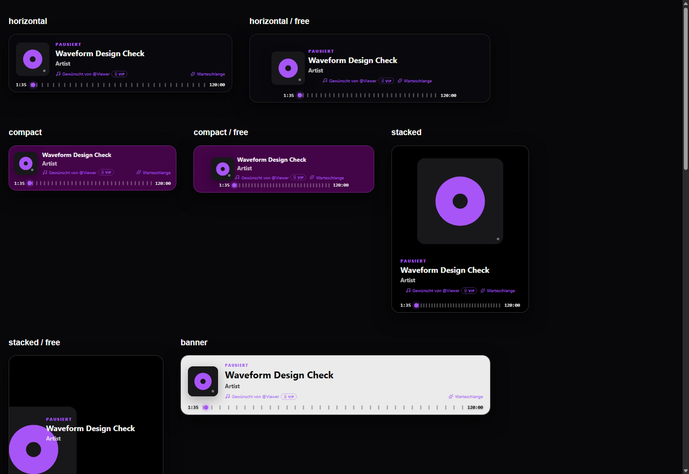

# DeEe Bot


DeEe Bot helps Twitch streamers manage song requests, design OBS overlays, and let viewers join in through chat.

**[Releases](https://github.com/DeEeLaBs/twitch-music-bot/releases) · [Quick start](#quick-start) · [Features](#features)**



*Music player layouts shown with sample data.*

## Features

### Music and song requests

Viewers can request songs with `!sr <link>`, through Twitch Channel Points when enabled, or via requests added by the streamer in the dashboard. Spotify and YouTube links can be matched on the selected playback service without switching players.

- Play music through Spotify Connect, the embedded YouTube Music player, or YTMDesktop Companion. The current source also includes NectarLink integration.
- Manage the queue with playback controls, request history, duplicate protection, cooldowns, limits, and blocklists.
- Save the current track locally with `!playlist` and sync it to a configured Spotify playlist. Unresolved or failed entries can be retried.

### OBS overlays and alerts

Build a countdown for your intro and a separate music-and-chat overlay for gameplay. Each overlay has its own OBS browser source URL and can run alongside the others.

- Arrange widgets in the visual editor and customize themes, layouts, colors, album art, and progress indicators. Music player styles include **Ashen – Inventory** in the current source.
- Create alerts for events such as follows, subscriptions, and Bits.
- Welcome individual viewers with a sound, GIF, or chat message.

### Chat games and viewer interaction

Start a quiz between matches. Viewers answer in chat while OBS shows the question and result.

- Play quizzes, number guessing, cooperative word guessing, and branching chat adventures. Supported games save scores and leaderboards.
- Browse quiz questions by category and use optional lifelines.
- Configure a prize wheel with custom labels and colors, then display it in OBS.

### Stream controls

- Run stream-start and subathon countdowns with dedicated OBS URLs. Configure time bonuses for Twitch events and donations from StreamElements, Streamlabs, or TipeeeStream.
- Use the local dashboard or Windows desktop app for setup, diagnostics, and chat commands.
- Put playback, queue, countdown, and chat game controls on your Stream Deck with the **DeEe Bot** plugin in the current source.

## Quick start

### Portable Windows download

The [v1.10.0 Windows release](https://github.com/DeEeLaBs/twitch-music-bot/releases/tag/v1.10.0) includes multiple OBS overlays, personal greetings, Spotify playlist sync, and cross-service song links. Chat games, the prize wheel, NectarLink, and Stream Deck game controls are part of the newer source code.

1. Download `MusicBot-1.10.0-Windows-x64-Portable.zip` from the release page and extract the entire archive.
2. Launch `Portable/MusicBot.exe`. Node.js and Electron are included. You need internet access and accounts for the services you connect.
3. Open **Setup** and connect Twitch and your music service. Spotify Connect requires Spotify Premium and a Spotify client ID.
4. In the **Overlay Designer**, copy the URL for the overlay you want and add it to OBS as a **Browser Source**.

See the [Windows setup guide](docs/STANDALONE.md) for installation and data migration.

### Run the current source (1.11.0)

1. Clone the repository or download and extract the ZIP for the `main` branch.
2. Install Node.js **22 or later**.
3. On Windows, run `Installieren.bat` to install dependencies and build the app.
4. Launch `MusicBot starten.cmd` and open the dashboard at <http://127.0.0.1:3000>.
5. Connect Twitch and your music service in **Setup**, then run diagnostics.

YouTube Music can run in the embedded player. If you use the separate YTMDesktop integration, it requires **YTMDesktop 2.x with Companion API v1**.

## Guides

Some guides are written in German.

- [Multiple OBS overlays](docs/MULTI_OVERLAYS.md) and [personal greetings](docs/GREETINGS.md)
- [Cross-service song requests](docs/CROSS_SERVICE_REQUESTS.md) and [Spotify playlist sync](docs/SPOTIFY_STREAM_PLAYLIST.md)
- [Chat games](docs/CHAT-GAMES.md), [prize wheel](docs/WHEEL.md), and [countdowns and subathons](docs/COUNTDOWN.md)
- [Stream Deck plugin](streamdeck-plugin/README.md)

## Chat commands

| Command | Access | What it does |
|---|---|---|
| `!sr <title or link>` | Everyone | Request a song |
| `!np`, `!song` | Everyone | Show the current song |
| `!queue` | Everyone | Show the queue |
| `!playlist` | Configurable | Save the current song and sync it if configured |
| `!play <answer>` | During a game | Join the active round |
| `!points`, `!points top` | Everyone | Show scores and the leaderboard |
| `!skip`, `!pause`, `!resume`, `!vol <0–100>` | Moderators and streamer | Control playback |
| `!veto <position or title>`, `!clearqueue` | Moderators and streamer | Moderate the queue |
| `!blacklist add/remove <term>` | Moderators and streamer | Manage song filters |

Change command permissions, aliases, cooldowns, and limits in the dashboard. The **Commands** section lists game controls available to moderators.

## Local data and security

The dashboard listens on `127.0.0.1` by default. API actions that change data require a local session. Access tokens are stored separately from standard settings and protected by DPAPI on Windows. Back up the local `data` folder before updating.

Test Twitch, your music service, OBS, and Stream Deck with your own setup before going live. Diagnostics can help identify connection problems.

## Development

The project uses TypeScript, React, Node.js, and Electron. Use Node.js 22 or later.

```sh
npm ci
npm run lint
npm test
npm run build
npm run test:smoke
```

Run `npm run dev` for hot reload or `npm run streamdeck:pack` to package the Stream Deck plugin.
